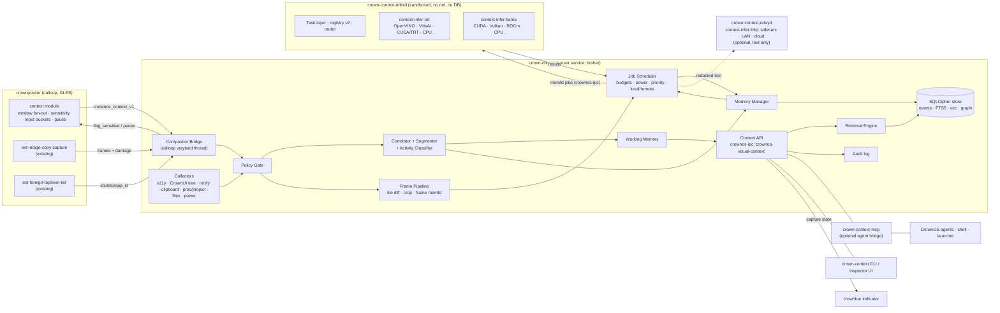
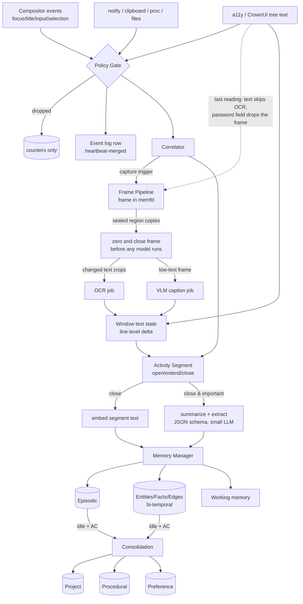
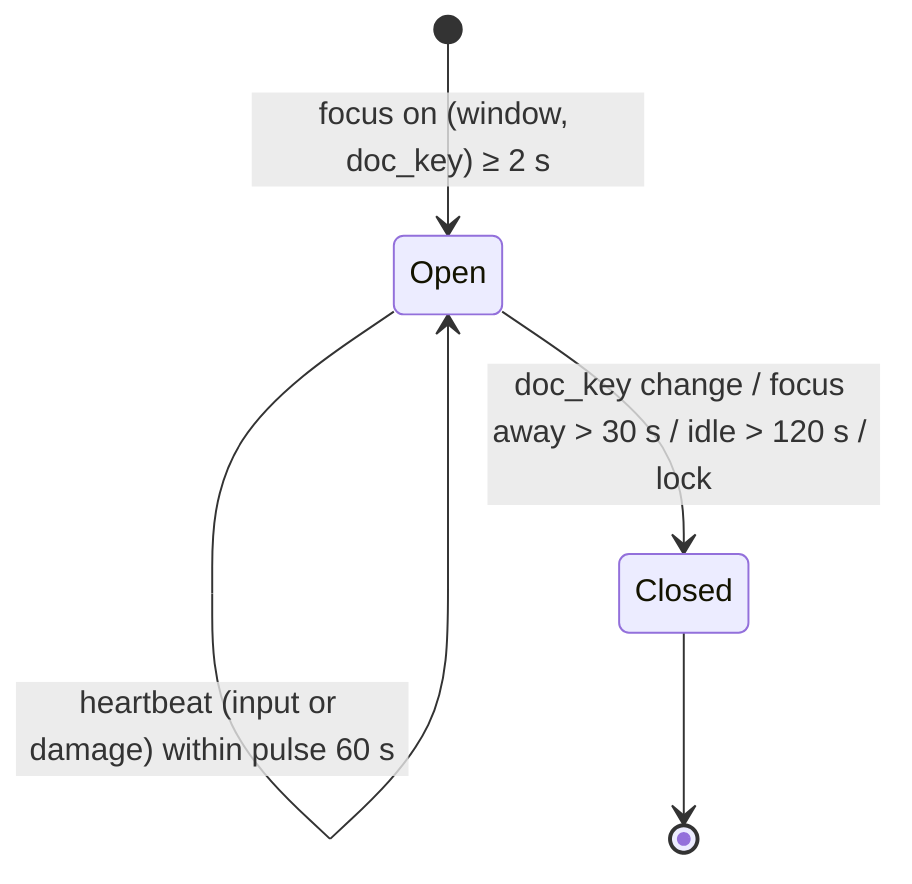

# 02 — Recommended System Architecture

Tags: **[V]** verified · **[R]** reported · **[A]** design decision / assumption to validate.

## 4. Architecture overview

Design rules:

1. **Observe ≠ understand.** Observation is cheap, synchronous, lossless for metadata. Frame analysis runs at capture time, and then the pixels are deleted; a frame is never kept for later. Text understanding (summaries, extraction) is asynchronous, budgeted, batched per *activity segment*, and may be deferred or skipped.
2. **The compositor never waits on VCGE.** All compositor→VCGE traffic is fire-and-forget Wayland events; capture is client-pulled.
3. **Fewest processes that give real isolation:** a key-holding broker (`crown-contextd`) and a sandboxed, network-less, DB-less inference worker (`crown-context-inferd`). Everything else is optional.
4. **One store, one writer.** SQLCipher SQLite, single writer task, read pool.
5. **Privacy is enforced at the earliest point that can enforce it** — compositor for pixels, policy gate for every observation, broker for every query.

### 4.1 Process topology



### 4.2 Why this shape (alternatives rejected)

| Alternative | Why rejected |
|---|---|
| Inference inside the compositor | Any stall/crash freezes the desktop; GPU contention with rendering. |
| Single monolithic daemon incl. models | NPU/GPU driver faults (e.g. cDSP crash on SIGKILL [R]) would take down the key holder and store; can't sandbox network/DB away from model code. |
| One microservice per component (OCR svc, vision svc, memory svc, …) | IPC overhead, N lifecycles, N failure modes for a single-user desktop. No isolation benefit beyond the two-process split. |
| PipeWire / portal for frames | Continuous-video semantics, consent dialogs, daemon hop; no per-window sensitivity veto; KDE-style indicator flashing [V screenpipe #7758]. |
| Python ML service | ORT + llama.cpp cover every model from Rust; Python adds ~300 MB+ RSS and a second packaging story. Python is used **only offline** in `tools/` for model export/quantization. |
| Graph DB / vector DB servers | Personal-scale (10⁴–10⁶ edges/vectors) fits SQLite; see [03-memory.md §9](03-memory.md#9-database-and-indexing). |

---

## 5. Compositor bridge: `crownos_context_v1`

XML in `crownos-protocols/protocols/crownos-context-v1.xml`; server impl in `crownpositor/compositor/src/context/`. **Version 2** (decision d): any app may bind. Each client gets the scope of its grant in `context_access.ron`, resolved from its `AppKey` ([05 §11.3](05-privacy-security.md#113-caller-identity-and-scopes)). Many clients can bind at once. On the Wayland protocol, only a client with the `engine` scope (crown-contextd) can pause observation for everyone ([07 §13.1.1](07-api.md#1311-crownos_context_v1-version-2)).

```
crownos_context_manager_v1                       (global, version 2, any client; filtered per scope)
  ── events ──
  window(new_id crownos_context_window_v1, string foreign_toplevel_identifier)
  focus(object<crownos_context_window_v1>? window, uint time_ms)
  session(uint state)                     # active | idle | locked
  input_activity(object window, uint interval_ms,
                 uint text, uint edit, uint nav, uint chords,
                 uint clicks, uint scroll_ticks, uint pointer_travel_bucket,
                 uint gestures, uint flags)        # flags: typing_paused, scroll_stopped
  selection(uint kind, object window?, string mime_types, uint size_hint, uint flags)
                                          # kind: clipboard|primary; flags: secret
  paused(uint paused, uint origin)        # origin: hotkey | engine | lock
  revoked                                 # v2: grant removed; object is inert
  ── requests ──
  set_paused(uint paused)                 # v2: pauses only this client's stream,
                                          # unless the client holds `engine`
  destroy

crownos_context_window_v1
  ── events ──
  process(fd pidfd, int pid)              # pidfd via SO_PEERPIDFD/pidfd_open
  sandbox(string engine, string app_id, string instance_id)
  placement(int x, int y, int w, int h, string output, uint workspace)
  state(uint flags)                       # fullscreen|maximized|minimized|visible|activated
  content_type(uint type)                 # wp_content_type: none|photo|video|game
  sensitivity(uint flags)                 # password_input|private_browsing|excluded|
                                          # app_requested|engine_flagged
  done
  closed
  ── requests ──
  flag_sensitive(uint reason, uint duration_ms)   # any bound client; rate-limited;
                                                  # engine-side detectors feed the veto
  destroy

crownos_capture_privacy_v1                       (global, any client)
  get_surface_privacy(new_id, wl_surface)  →  set_excluded(uint excluded)
                                          # app-level analogue of WDA_EXCLUDEFROMCAPTURE
```

Compositor implementation notes [A]:

- **Window fan-out:** one internal `WindowEvent` enum produced at the existing choke points (`update_keyboard_focus`, `title_changed/app_id_changed`, map/unmap, `refresh_foreign_toplevels`) and fanned out to both `crownos_context_v1` **and the already-declared `crownos_plugin_host_v1` window events** (fixing that gap for crownplugind for free).
- **Sensitivity state machine** per toplevel: OR of `text-input purpose ∈ {Password, Pin}`, private-browsing rule match, policy exclusion (pushed by contextd as rule set — see below), `crownos_capture_privacy_v1`, engine flag (with expiry), session locked.
- **Capture veto:** VCGE's `ext-image-copy-capture` sessions for a sensitive window fail frames (`failed` reason `stopped`) and `capture_constraints` returns `None` for excluded sources; output-source capture by VCGE is disabled by default (window-only capture). Output screencopy and screencast for other clients blank sensitive windows.
- **Per-client scope:** `ContextState.bound` is a list of bound clients, each with its scope. A `metadata` client gets no `title` and no `selection` events. On a config reload the compositor recomputes every scope and sends `revoked` where a grant is gone.
- **Exclusion rules** (app_id globs, title regexes per locale) are read by the compositor from `~/.config/crownos/visual_context.ron` via `crownos-config::subscribe_typed` so the veto works **even when contextd is not running or is compromised**.
- **Input buckets:** counters in the input path; emission timer every 2 s only when non-zero; text counters zeroed while sensitive.
- **Pause hotkey** (default `Super+Shift+.`, configurable) toggles compositor-side pause: no context events, all VCGE captures fail; indicator updated.
- **Cost budget:** < 50 µs per event emission, zero allocation in the input path, no blocking I/O. Verified by a benchmark in Phase 1.

---

## 6. Component responsibilities and boundaries

All in Rust (edition 2024, toolchain pinned with the rest of CrownOS). `thiserror` in libraries, `anyhow` in binaries, `tracing` logging (journald).

| # | Component | Lives in | Responsibilities | Inputs → Outputs | Interfaces | Failure handling | Resources (target) |
|---|---|---|---|---|---|---|---|
| C0 | **Compositor context module** | crownpositor | Window fan-out, pid/pidfd, sensitivity + veto, input buckets, selection metadata, pause | Smithay hooks → Wayland events | `crownos_context_v1`, `crownos_capture_privacy_v1` | Never blocks; if client is slow, Wayland buffers; client disconnect = all VCGE sessions dropped | < 50 µs/event, ~0 RAM |
| C1 | **Compositor Bridge** | contextd (dedicated calloop thread) | Bind globals, maintain window table keyed by foreign-toplevel id, own capture sessions (focused window only), forward typed `Observation`s | Wayland → bounded channel | crate `context-collect::compositor` | Reconnect with backoff; on reconnect rebuild window table; missing global → degrade to metadata-less mode and report status | 1 thread, < 5 MB |
| C2 | **Accessibility Extractor** | contextd (tokio task) | Session-wide bus (`IsEnabled` set at session start). Event-driven subscription to a minimum event set; text fetch by `GetMatches` (Qt, ATK bridge), `GetItems` (GTK4) or a bounded concurrent walk; Chromium call allowlist; SHOWING/VISIBLE filter; URL (`DocURL`); password-role detection → `flag_sensitive` for 60 s, set again on each read while the field stays, plus a local mark. Keeps the last reading of each window (`RecentReadings`) for the capture path, and reads the focused window at once when a capture asks. A window without an a11y application gets "no text" at once. Each read passes the content gate ([05 §11.6](05-privacy-security.md#116-analyse-then-delete)) | a11y events → `A11yText`, `SensitiveHint`, last reading per window | `atspi` 0.30 | Per-app timeouts (200 ms), node budget (2,000), adaptive backoff, dead/hung object cache, SimHash dedup | < 10 MB |
| C3 | **CrownUI Tree Reader** | contextd | **Not built.** Until it exists, CrownUI apps are read through AT-SPI (C2). Plan: for CrownUI apps with agent-access grant, read `ui://tree` via MCP socket | MCP → `A11yText` (structured) | `crownui/mcp` client | Missing grant → skip | small |
| C4 | **System Collectors** | contextd | Notifications (crownotify `NotificationPosted`), clipboard content for allowed sources (crownos-clipboard `get`), process/app/project resolution (pidfd→cgroup→desktop entry; terminal cwd→git root), recent files (`recently-used.xbel`), power/PSI/thermal/NVML | IPC/proc/inotify → `Observation` | crownos-ipc clients, `monitor-system` resolver | Each collector independent; failures logged + status flag | < 10 MB |
| C5 | **Policy Gate** | contextd (inline) | Every observation and every derived artifact passes: exclusions, sensitivity, per-app text/clipboard/notification permissions, secret detectors (regex+entropy), retention class assignment | `Observation` → `Admitted<Observation>` or drop + counter | crate `context-policy` | Fail **closed**: unknown policy state = drop | µs per item |
| C6 | **Frame Pipeline** | contextd (`spawn_blocking`, semaphore 1) | Capture scheduling per trigger, content gate, frame in a per-capture memfd, a11y reading newer than the request first (text → no OCR; password field → frame dropped unread; no text → OCR; none yet → zero the frame, then wait ≤ 300 ms with no copy; no OCR for that frame without it), damage-restricted tile hashing, volatile-region masking, crop of changed text regions, region copies sealed with `F_SEAL_WRITE` for the models, then zero and close the frame before any model runs; OCR and VLM-caption jobs on the copies, secret detection on the result ([05 §11.6](05-privacy-security.md#116-analyse-then-delete)) | trigger + frame + damage + a11y reading → `OcrJob`, `CaptionJob` → text lines, caption, `FrameRecord` (with `secret_seen`) | crate `context-capture` | Frame failure/veto → record "capture_denied" metric only; never retry sensitive. RAM queue ≤ 3 frames / 64 MB, 60 s TTL, then `frame_dropped_unanalysed`. Output waits ≤ 30 s for its segment, then is dropped. A secret flags the window for 10 min, also locally when the compositor does not take the flag. A hold (sleep, pause, lock, identity exposure) cancels the wait for the a11y reading and for inferd, and sends `cancel(job_id)` to inferd | ≤ 1 capture / 2 s hard cap; < 15 ms CPU per capture excl. OCR |
| C7 | **Correlator + Segmenter + Classifier** | contextd | Sliding 10-min event window; joins (input→damage→capture cause, copy→source window, notification→app), heartbeat-merged **activity segments**, task-level **episodes**, activity labels (rules + embedding centroids) | `Admitted<Observation>` → `SegmentEvent`, `EpisodeEvent`, `WorkingMemory` updates | crate `context-engine` | Pure, deterministic, replay-testable; state snapshotted every 60 s | < 20 MB |
| C8 | **Working Memory** | contextd (in-RAM) | Current focus, segment, episode guess, recent entities (LRU 64), open documents, last N segment summaries | C7 → API | API `current_context`, subscriptions | Snapshot/restore on restart | < 5 MB |
| C9 | **Memory Manager** | contextd | Persist segments/episodes; request derivations (embed, summarize, extract); entity resolution; fact upsert with bi-temporal invalidation; provenance; importance/confidence; deletion cascade | events + job results → store rows | crate `context-engine::memory` | Idempotent writes keyed by content hash; jobs retried with backoff, expired by deadline | — |
| C10 | **Job Scheduler** | contextd | Priority queue with deadlines; for text-only tasks, picks local (inferd) or remote (relayd) and falls through on `Unavailable` or `Busy`; vision jobs go only to inferd ([04 §10.4](04-inference.md#router)); per-tier token buckets (captures, OCR, embed, LLM, VLM, cloud) scaled by power/thermal/PSI/fullscreen-game; batching; dispatch to inferd (frames and text) or relayd (text only) | jobs → inferd / relayd requests | crownos-ipc + memfd | Back-pressure: coalesce (latest wins per window), drop expired, never unbounded. Frame jobs are never persisted | — |
| C11 | **Consolidation Worker** | contextd job set (runs in inferd for model work) | Idle+AC: day/episode rollups, project memory refresh, fact dedup/invalidation, procedure mining, preference updates, retention pruning, re-embedding of stored text after a model change, vacuum | store → store | internal | Checkpointed, resumable, abortable on user activity | runs only when idle |
| C12 | **Retrieval Engine** | contextd | Hybrid search (FTS5 BM25 + vector KNN + graph expansion + temporal filters) fused by RRF, optional rerank, context packing with token budget and caller-scope redaction | query → ranked results / `ContextPack` | crate `context-engine::retrieve` | Timeouts per stage, partial results flagged | p95 < 150 ms (no rerank) |
| C13 | **Store** | contextd | Schema/migrations, single writer task (coalesced transactions), read pool. No pixels | rows ↔ SQLite | crate `context-store` | WAL, `synchronous=NORMAL`, integrity check at startup, auto-backup of key metadata | — |
| C14 | **Context API** | contextd | Typed crownos-ipc service; caller `AppKey` (`SO_PEERPIDFD`, opt-in `SO_PASSPIDFD`), per-request scope check against `context_access.ron`, live revocation, rate limits, audit | requests → replies/events | [07-api.md](07-api.md) | Per-connection limits (crownos-ipc: 32 conns/uid, 64 subs) [V] | — |
| C15 | **Inference Worker** | `crown-context-inferd` | Task layer and router over the ort and llama backends ([04 §10.4](04-inference.md#104-model-layer-in-context-infer)), model load/unload on idle, tasks (`recognize_text`, `describe_screen`, `embed_text`, `rerank`, `summarize_segments`; `ui_detect` later, Phase 8) | job (memfd payload) → result | crownos-ipc `crownos-visual-context-infer` | Crash → systemd restart; contextd requeues in-flight text jobs once, frame jobs only within their TTL; circuit breaker per (runtime, device) falls through to the next candidate | see [06](06-performance.md) |
| C16 | **HTTP backend host** (optional) | `crown-context-relayd` | `context-infer-http` with its own router: OpenAI-compatible local sidecars, LAN node (DGX Spark), cloud APIs. Consent check, re-verify redaction, audit every request. Text only | redacted text → response | crownos-ipc; HTTP(S) | Not started until an endpoint is configured; network restricted by `IPAddressAllow` | ~10 MB, on demand |
| C17 | **Agent bridge** (optional) | `crown-context-mcp` | Expose API as MCP tools/resources for CrownOS agents with the agent's scopes | MCP ↔ API | rmcp (as crownui) | Stateless | small |
| C18 | **CLI / Inspector** | `crown-context`, later CrownUI app in crownos-settings | Inspect, search, explain provenance, forget, pause, export, benchmark | — | API | — | — |

**Lifecycle:** `crown-contextd.socket` + `.service` as **systemd user units** (pattern of `crown-voiced` [V]) started at graphical session; `crown-context-inferd` socket-activated by contextd's first job and exits after configurable idle (default 10 min) to release model memory; relayd socket-activated only if an HTTP endpoint is configured. contextd stops all capture on `session=locked` and on `paused`. It also holds captures during sleep and while it connects to Wayland.

---

## 7. Event and data-flow diagrams

### 7.1 Observation → memory (end-to-end)



### 7.2 Capture sequence (one trigger)

```mermaid
sequenceDiagram
  participant C as crownpositor
  participant B as Bridge (contextd)
  participant P as Policy
  participant F as Frame Pipeline
  participant I as inferd
  C->>B: input_activity(win, typing_paused)
  B->>P: trigger(win, TypingPause)
  P-->>B: allowed (content gate, budget ok, not video/game)
  B->>C: ext_image_copy_capture_frame.capture() on win session
  alt window sensitive
    C-->>B: failed(stopped)
  else
    C-->>B: ready + damage[rects]
    B->>F: frame (shm in a per-capture memfd), damage
    F->>F: a11y reading of win newer than the request (asked for at the request; no wait)
    alt password field
      F->>F: drop the frame unread, no frame record
    else no reading yet
      F->>F: zero the frame first, then wait ≤ 300 ms (a hold stops the wait); no OCR without it
      opt the reading gives no text
        F-->>B: capture the window once more, with OCR when no reading is there
      end
    else
      F->>F: hash 32px tiles inside damage, mask volatile regions
      F->>F: copy regions into memfds sealed with F_SEAL_WRITE
      F->>F: zero the frame, close its memfd
      opt no a11y text
        F->>I: OCR(det+rec) on the changed crop copy
        I-->>F: lines + boxes + confidences
      end
      opt low-text frame, damage ≥ 50 %, not on battery
        F->>I: describe_screen(copy of the whole frame)
        I-->>F: content_kind, caption, visible_entities
      end
      F->>F: secret detectors on text, close the copies
      F->>B: TextDelta(win, +lines, -lines), caption?, FrameRecord
    end
  end
```

### 7.3 Capture triggers and gating [A]

| Trigger | Source | Settle delay | Notes |
|---|---|---|---|
| Focus change | compositor `focus` | 400 ms (skip if focus leaves sooner — alt-tab flicker) | Always 1 capture per new segment |
| Title / URL change | foreign-toplevel / a11y | 400 ms | New document/page |
| Typing pause | `input_activity.flags.typing_paused` | 1.5 s after last text key | Only if text keys > 0 in segment |
| Scroll stop | `scroll_stopped` | 500 ms | Line cache dedups re-OCR of shifted lines |
| Copy | `selection(clipboard)` | 0 | Captures source window context of the copy |
| Damage settled | damage area > 3 % of window, then quiet 750 ms | — | Catches content arriving without input (page load, build output) |
| Idle backstop | timer | 60 s AC / 300 s battery | Only if damage occurred since last capture |

Gates (all must pass): not paused · window not sensitive/excluded · `content_type ∉ {video, game}` · window not fullscreen-video heuristic (continuous damage > 70 % for > 5 s) · capture bucket has a token · system not under PSI pressure (`cpu some avg10 > 40 %` defers).

### 7.4 Segment and episode model



- **doc_key** = first available of: CrownUI document id · a11y `DocURL` · file path (title/`/proc/<pid>/fd`) · terminal cwd/git root · normalized title (strip counters, unread badges, app suffix).
- **Episode (task)** = chain of segments joined when gap < 10 min **and** (same project **or** shared entities **or** cosine(segment embeddings) > 0.75); closes after 20 min without a joining segment. Episodes are the unit of episodic memory and of LLM summarization above segment level.
- Focus flickers < 2 s become `transition` events (used by procedural mining), not segments.

### 7.5 Activity classification [A]

Two-stage, no per-event LLM:

1. **Rules/priors:** desktop-entry `Categories`, app_id prior table, URL domain category list, terminal command class (from title), content_type.
2. **Embedding nearest-centroid** over (app, title, domain, top OCR/a11y keywords) against label prototypes (taxonomy below + user corrections as new prototypes). Margin = confidence.
3. If margin < threshold, the label is (re)assigned by the segment-summary LLM call that happens anyway.

Taxonomy v1: `coding, code_review, terminal_ops, reading_docs, research_browsing, writing, spreadsheet, design, communication_chat, email, meeting, media_consumption, gaming, admin_settings, file_management, shopping, finance, learning, other`.
