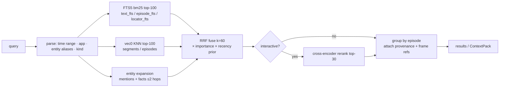

# 03 — Memory Taxonomy, Schemas, Database and Indexing

Tags: **[V]** verified · **[R]** reported · **[A]** design decision / assumption to validate.

## 8. Memory taxonomy

### 8.1 Principles (from Graphiti, Mem0 v3, LangMem, Letta — see [01 §1.2](01-research.md#12-patterns-adopted))

1. **Evidence is immutable; knowledge is append-plus-invalidate.** No LLM ever issues an in-place UPDATE/DELETE of knowledge; contradictions close validity intervals.
2. **Bi-temporal knowledge:** `valid_from/valid_to` (when true in the world) and `recorded_at/expired_at` (when VCGE believed it).
3. **Provenance on every derived row** (`evidence` table) — "why do you remember this?" is always answerable.
4. **Two deletion semantics:** *retention expiry* removes raw evidence but keeps derived memories (with a short redacted snippet as provenance); *user deletion* cascades — derived memories whose only support was deleted are removed, others lose that evidence and get re-scored.
5. **Confidence and importance are separate numbers.** Confidence = how likely true; importance = how useful to recall.

### 8.2 The seven memory types

Storage shapes: **E** = event log, **S** = segments/episodes, **G** = entities + facts graph (bi-temporal), **P** = profile documents (project, preference), **Q** = procedures.

| Type | Stores | Generated by | Updated by | Retrieved via | Retention (default) | Confidence & provenance | Relationships |
|---|---|---|---|---|---|---|---|
| **Working** | Current focus, open segment, current episode guess, recent entities (LRU 64 with scores), open documents per window, last 10 segment summaries, recent clipboard metadata | Correlator in real time (no models) | Every admitted observation | `current_context`, `subscribe(context)` | RAM; snapshot persisted 60 s; discarded after 12 h inactivity | Each item tagged with source + age | Points into S and G ids |
| **Episodic** (S) | Segments (app, doc_key, title/url/file, time, active time, input profile, label, text lines, capture records without pixels) and episodes (task-level chains) with summaries; day/week rollups | Segmenter; summaries by small LLM at segment/episode close; rollups in consolidation | Immutable after close (summaries can be re-generated from stored text with a model upgrade, versioned) | Timeline, hybrid search, `episode(id)` | Raw text lines and capture records 30 d; segments+episodes 1 y; rollups indefinite. No pixels are stored | Summary carries model id, input coverage (a11y/OCR/VLM %), confidence | Episode → segments → frames/text; episode ↔ project; mentions → entities |
| **Semantic** (G) | Facts: `(subject, predicate, object_entity \| value)` e.g. *"crownpositor uses smithay 0.7"*, *"Alice is reviewer of PR #412"* | Entity/fact extraction (JSON-schema LLM) at segment close + deterministic extractors (URLs, paths, repos, emails, issue keys) | New evidence → noisy-OR confidence update; contradiction → old fact `valid_to` set, new fact inserted | Entity lookup, graph expansion in hybrid search, `facts(entity)` | Until invalidated or user-deleted; unconfirmed facts with confidence < 0.3 expire after 90 d | Per-source reliability × extractor conf; evidence rows | subject/object → entities; evidence → segments |
| **Relational** (G) | Entities (person, org, project, repo, document, file, url/site, app, topic, meeting, issue) + relation facts (`works_on`, `mentions`, `authored`, `opened_with`, `part_of`, `discussed_in`, `co_occurs_with`) | Same extraction; co-occurrence edges computed in consolidation (PMI over episodes) | Entity resolution (exact alias → string+embedding similarity → LLM adjudication only when ambiguous); merges recorded as alias + `merged_into` | `entity(ref)`, neighbors (recursive CTE, ≤ 2 hops) | Entities live while referenced; orphan entities pruned after 180 d | `mention_count`, `last_seen`, merge history | Facts are the edges |
| **Project** (P over G) | Project entity + profile document: root path / repo remote, goals, recent activity summary, key files/docs/URLs, people, open items (TODO/issue keys seen), last-state snapshot ("where you left off") | Projects detected from git roots, document folders, recurring doc_keys/entities clusters; profile (re)written in consolidation by LLM from episodes + facts | Profile versioned (append new version); open items closed when evidence shows resolution | `project(ref)`, project-scoped search, `resume_context(project)` | While active; archived after 180 d inactive (still searchable) | Profile sections cite episode ids | project ↔ episodes, entities, procedures |
| **Procedural** (Q) | Recurring workflows as symbol sequences with timing constraints, e.g. `focus(editor) → copy(src=terminal) → focus(browser, domain=github.com) → paste` | Sequential pattern mining (PrefixSpan-style, max-gap constrained) over symbolized events per episode, in consolidation; LLM names/describes confirmed patterns | Support/confidence recomputed on each run; state `candidate → offered → confirmed/dismissed` | `procedures(filter)`, `subscribe(procedure_detected)` | Candidates decay if unseen 30 d; confirmed kept until dismissed | support, confidence, instance list | instances → episodes; procedure ↔ project/apps |
| **Preference** (P) | Observed patterns: preferred apps per task, working hours, theme/layout habits, focus-time windows, communication channels, file locations, languages | Aggregations in consolidation (counts per context) + explicit user statements via API | Beta(α, β) posterior per preference; time-decay half-life 30 d | `preferences(scope)`, included in `ContextPack` | Until decayed below threshold or user-deleted | α/β, evidence count, `user_confirmed` flag | scope → app/project/global |

### 8.3 Scores

- **Source reliability** (prior, configurable): CrownUI tree 0.98 · AT-SPI 0.95 · compositor metadata 1.0 · OCR = mean line confidence · VLM 0.6 · LLM-inferred (not directly observed) 0.5 · user-asserted 1.0.
- **Fact confidence:** `c = 1 − Π(1 − rᵢ·eᵢ)` over evidence i (reliability × extractor confidence), capped at 0.99; time-sensitive predicates (`status`, `assigned_to`, `version`) decay toward 0.5 with half-life set per predicate.
- **Segment importance** (0–1): weighted sum of log(active time), input intensity, revisit count (doc_key on ≥ N distinct days), explicit actions (copy/paste/save/share), project association, entity novelty, user pin. Weights tuned in Phase 7 from retrieval click-through.

---

## 9. Database and indexing

### 9.1 Decision: one SQLCipher SQLite database, no pixels

| Need | Choice | Why (vs alternatives) |
|---|---|---|
| Event log, segments, episodes | SQLite STRICT tables, integer µs timestamps, JSONB payloads | Proven, tiny footprint, already used in CrownOS (`rusqlite` 0.41 in process-monitor [V]) |
| Encryption at rest | **SQLCipher** via `rusqlite` `bundled-sqlcipher` [V] | Page-level, covers FTS5 and vec0 shadow tables [V]; AES-NI / ARMv8 crypto ext. |
| Full-text | **FTS5** external-content on `text_lines`, `segments`, `episodes`; trigram FTS on URLs/paths/code identifiers | Screenpipe converged on this [V]; tantivy only if ranking proves insufficient |
| Vectors | **sqlite-vec 0.1.9** `vec0` brute-force, **int8, Matryoshka-truncated to 256 dims**, partitioned by month [V] | 1 year ≈ 110 k segment vectors × 256 B ≈ 28 MB → brute-force scan ≈ 10–20 ms [A]. DiskANN in sqlite-vec is alpha [V] → don't depend on it. Escape hatch: **usearch** mmap HNSW sidecar, rebuildable from SQLite [V]. |
| Graph | Plain `entities`, `facts` tables + recursive CTEs (≤ 2 hops) | Personal scale 10⁴–10⁶ edges. Kuzu archived (Apple, 2025-10) [V], Cozo dormant [V], SurrealDB BSL [V]. |
| Bi-temporal | Columns + partial indexes `WHERE expired_at IS NULL` | Graphiti model without a graph server |
| Pixels | None stored. A frame lives only in RAM while it is analysed ([05 §11.6](05-privacy-security.md#116-analyse-then-delete)) | Decision a: analyse, then delete. No media directory, no image embeddings |
| Persistent job queue | `jobs` table, text jobs only | Derivations survive restarts/crashes. Frame jobs stay in the RAM queue and are never written here |
| Audit | Separate SQLCipher file `audit.db`, append-only, hash-chained rows | Tamper-evident; deleting memories never deletes audit of the deletion |

Connection model: one writer thread owning the write connection, coalescing batches into one `BEGIN IMMEDIATE … COMMIT` every ≤ 250 ms (screenpipe pattern [V]); 2 read connections; `journal_mode=WAL`, `synchronous=NORMAL`, `cache_size` and `mmap_size` set per hardware profile.

### 9.2 Schema sketch (normative columns; final DDL written in Phase 4/5)

```
apps(id PK, app_key UNIQUE, app_id, desktop_entry, name, category, sandbox_engine)

events(id PK, kind, app_id→apps, window_ident, t_start, t_end, payload JSONB, retention)
   -- heartbeat-merged: focus, title, url, idle, input_bucket, selection, notification, file
   INDEX(t_start), INDEX(kind, t_start)

segments(id PK, episode_id→episodes, app_id→apps, doc_key, title, url, file_path, cwd,
         project_id→entities, t_start, t_end, active_ms, input_profile JSONB,
         activity_label, label_conf, importance, text_coverage, summary, summary_model,
         state)                                   -- open|closed|summarized
frames(id PK, segment_id, t, trigger, width, height, damage_ratio, content_kind, line_count)
   -- capture record only, no pixels; the VLM caption is a text_lines row with source=vlm
text_lines(id PK, segment_id, frame_id, source, line_hash, text, bbox, conf, t_first, t_last)
   -- dedup by (segment_id, line_hash); source: crownui|a11y|ocr|vlm
text_fts   FTS5(text, content='text_lines', tokenize='unicode61 remove_diacritics 2')
locator_fts FTS5(url, file_path, title, content='segments', tokenize='trigram')

episodes(id PK, level, parent_id, t_start, t_end, title, summary, activity_label,
         project_id, importance, confidence, model, version)  -- level: task|day|week
episode_fts FTS5(title, summary, content='episodes')

entities(id PK, kind, name, attributes JSONB, first_seen, last_seen, mention_count,
         importance, merged_into, state)
entity_aliases(entity_id, alias, alias_norm, source)  INDEX(alias_norm)
facts(id PK, subject_id, predicate, object_id NULL, object_value NULL,
      valid_from, valid_to, recorded_at, expired_at, confidence, importance)
   INDEX(subject_id, predicate) WHERE expired_at IS NULL
   INDEX(object_id)            WHERE expired_at IS NULL
mentions(entity_id, segment_id, t, span)

projects(entity_id PK, root_path, repo_remote, status, profile JSONB, profile_version,
         last_active)
procedures(id PK, name, pattern JSONB, support, confidence, avg_duration_ms,
           first_seen, last_seen, state)
procedure_instances(procedure_id, episode_id, t_start, t_end)
preferences(id PK, scope, key, value JSONB, alpha, beta, half_life_days,
            first_seen, last_seen, user_confirmed, state)

evidence(memory_kind, memory_id, source_kind, source_id, snippet, weight, t)
   -- snippet: ≤ 200 chars, redacted; survives retention expiry, not user deletion

embedding_spaces(id PK, model, dims, quant, created)
vec_segments  vec0(embedding int8[256], space_id, month PARTITION KEY)
vec_episodes  vec0(embedding int8[256], space_id)
vec_entities  vec0(embedding int8[256], space_id)

jobs(id PK, kind, target, priority, deadline, attempts, state, not_before)
working_memory(id = 1, snapshot BLOB, t)
```

### 9.3 Hybrid retrieval



- Query parsing is deterministic (time expressions, app names from `apps`, alias lookup); no LLM in the retrieval hot path.
- Temporal filters are hard filters; recency is a soft prior only when the query has no time expression.
- **ContextPack** (for agents): working memory + top-k episodes + project profile + current-valid facts (with validity intervals) + relevant preferences, rendered compactly within a caller-specified token budget and the caller's redaction scope.

### 9.4 Storage estimates [A — validate in Phase 5 soak]

| Data | Per active day (8 h) | Notes |
|---|---|---|
| events (heartbeat-merged) | 1–3 MB | ActivityWatch-like density |
| segments + episodes + facts | 1–2 MB | ~150–400 segments/day |
| text_lines + FTS | 10–40 MB | after line dedup; dominated by browsing/reading |
| vectors | < 0.2 MB | 256-dim int8 |
| pixels | 0 | Frames are deleted after analysis |
| **Total** | **~15–50 MB** | Default quota 10 GB, oldest-first eviction of raw tiers |
