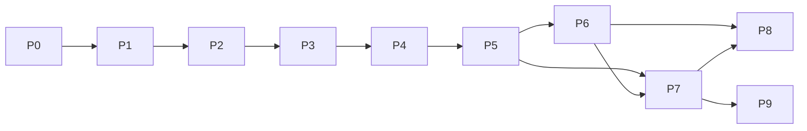

# 08 — Implementation Plan

Tags: **[V]** verified · **[R]** reported · **[A]** design decision / assumption to validate.

## 14. Repository and crate structure

Cargo workspace in this repo (edition 2024, resolver 3, release profile `lto="thin"`, `codegen-units=1`, `strip` — CrownOS convention [V]). Utilities live in `src/util/<name>.rs` inside each crate. Libraries use `thiserror`, binaries `anyhow`; logging via `tracing` + `tracing-journald`.

```
crownos-visual-context-engine/
├── Cargo.toml                    # [workspace]
├── crates/
│   ├── context-protocol/         # public wire contract (crownos-ipc protocol!), shared IDs/types; no daemon deps
│   ├── context-core/             # Observation, Trigger, Segment/Episode domain types, time, ids (newtypes)
│   ├── context-policy/           # rules (RON via crownos-config), sensitivity, secret detectors, scopes, consent
│   ├── context-store/            # SQLCipher schema + migrations, writer task, read pool, FTS5/vec0 queries, media AEAD, audit chain
│   ├── context-collect/          # compositor bridge (calloop wayland client), a11y, crownui tree, notify, clipboard, proc/project, files, power
│   ├── context-capture/          # capture scheduling, damage tiles, volatile masks, crops, thumbnails, line cache
│   ├── context-engine/           # correlator, segmenter, classifier, working memory, memory manager, scheduler, consolidation, retrieval
│   ├── context-infer/            # backend traits, OrtBackend, LlamaBackend, SidecarBackend, model registry, task impls (ocr/embed/generate)
│   ├── crown-contextd/           # bin: broker daemon (tokio, 2 workers + wayland thread + writer thread)
│   ├── crown-context-inferd/     # bin: inference worker
│   ├── crown-context-relayd/     # bin: optional cloud/LAN relay
│   ├── crown-context-mcp/        # bin: optional MCP agent bridge
│   └── crown-context/            # bin: CLI (status, search, timeline, explain, forget, pause, export, bench)
├── models/registry.ron           # model catalog (task → candidates, sha256, licence, shapes, EPs)
├── packaging/systemd/            # *.socket, *.service user units + preset
├── eval/                         # corpora manifests, gold sets, trace fixtures (synthetic, privacy-safe)
├── tools/                        # offline model export/quantization scripts (Python allowed; not shipped)
└── docs/                         # this blueprint
```

Cross-repo work items are listed in [07 §13.6](07-api.md#136-changes-to-existing-crownos-interfaces). Dependencies on siblings via path deps with `[patch]` (CrownOS convention [V]).

## 15. Implementation phases

Each phase is independently testable and ends with a demo + measured acceptance criteria. "Depends on" lists hard prerequisites only.

### Phase 0 — Foundations and de-risking spikes

**Features:** workspace scaffold, CI gates, benchmark harnesses, hardware bake-off, protocol drafts.

**Steps (todo list):**
1. Scaffold workspace + crates (empty APIs), CI: `cargo fmt --check`, `clippy -D warnings`, `cargo test`, `cargo deny` (licences), x86_64 **and aarch64** cross builds.
2. Draft `crownos_context_v1.xml` + `crownos_capture_privacy_v1.xml`; review with compositor owners.
3. Hardware bake-off (`bench-ocr`, `bench-embed`, `bench-llm`) on: one Intel LNL/PTL, one AMD Ryzen AI 300, one Snapdragon X (Ubuntu 26.04), one NVIDIA dGPU, one DGX Spark. Record EP × model latency/accuracy/memory → fills `registry.ron`.
4. Spikes: (a) `llama-cpp-2` dynamic ggml backends (CUDA/Vulkan) in one binary; (b) `ort` rc.15 `load-dynamic` with OpenVINO/VitisAI/QNN/CUDA EPs on CrownOS ORT packages; (c) sqlite-vec + SQLCipher in one `rusqlite` build; (d) AT-SPI cost with `IsEnabled` on a browser-heavy session; (e) `SO_PEERPIDFD` on target kernels.
5. Build OCR eval corpus (500 crops, synthetic + self-captured with consent) and synthetic "day in the life" trace generator.

**Dependencies:** none. **Interfaces:** draft XML, `registry.ron` schema.
**Testing:** harnesses run in CI on CPU; hardware runs manual with results committed to `eval/results/`.
**Acceptance:** every [A] item in 04-inference §10.3 for T2–T5 confirmed or replaced; spike reports written; aarch64 build green.

### Phase 1 — Compositor integration and contextual event collection

**Features:** `crownos_context_v1` server in crownpositor (window fan-out incl. plugin-host events, pid/pidfd, sensitivity state machine without engine flags, input buckets, selection metadata, idle/lock, pause hotkey); contextd skeleton with compositor bridge, policy gate (exclusions), heartbeat-merged event log (unencrypted dev DB allowed only in this phase), `crown-context status/tail` CLI.

**Steps:**
1. crownos-protocols: XML + generated server/client bindings.
2. crownpositor: `context/` module; hook `update_keyboard_focus`, title/app_id/map/unmap, `refresh_foreign_toplevels`, text-input activation, `new_selection`, idle/lock; input bucket counters; hotkey; emit plugin-host window events.
3. contextd: calloop wayland thread → bounded channel → tokio; window table keyed by foreign-toplevel identifier; pidfd → cgroup app resolution (reuse `monitor-system` resolver); policy gate v0; event log writer.
4. CLI `crown-context tail` prints live observations.

**Dependencies:** Phase 0 (XML approved).
**Interfaces:** `crownos_context_v1`, `crownos_plugin_host_v1` events, `context-core::Observation`.
**Testing:** compositor unit tests for sensitivity state machine and bucket aggregation (incl. password zeroing); integration test with nested (winit) crownpositor + scripted GTK/Qt test clients; `bench-compositor`.
**Acceptance:** focus/title/app/pid events for native + XWayland windows within 16 ms of change; password-purpose input yields zero text counts; no frame-time regression (§12.1); crownplugind receives window events.

### Phase 2 — Screen capture and accessibility extraction

**Features:** capture scheduler with trigger set (§7.3), focused-window `ext-image-copy-capture` sessions (shm), damage tiles, volatile-region masks, thumbnails (policy-gated), compositor sensitivity veto, engine `flag_sensitive`; AT-SPI extractor (focused subtree, DocURL, password role); CrownUI tree reader; crownbar indicator; notifications (crownotify `NotificationPosted`) and clipboard metadata/content collectors.

**Steps:**
1. Compositor: veto in `capture_constraints`/frame path for VCGE client; indicator state.
2. `context-capture`: session lifecycle (only focused window), trigger debounce/gates, tile hashing within damage, crop extraction, JPEG thumbnail + AEAD media writer.
3. `context-collect::a11y`: event subscriptions, budgeted subtree fetch, pid+title window mapping, password detection → `flag_sensitive`.
4. crownotify + crownbar changes; clipboard collector honoring secret hint and per-app allowlist.

**Dependencies:** Phase 1.
**Interfaces:** `ext-image-copy-capture-v1`, AT-SPI, crownotify/crownos-clipboard IPC, `crownos_capture_privacy_v1`.
**Testing:** privacy red-team suite v1 (password field in GTK/Qt/Chromium, Firefox private window, excluded app, locked session, app self-exclusion) asserting **zero pixels and zero text stored**; capture-rate tests from replayed traces; a11y budget tests against a huge DOM page.
**Acceptance:** red-team suite 100 % pass; captures/min within §12.1 on a 1-h scripted session; a11y text available for GTK/Qt/Firefox/Chromium(flag) apps; indicator reflects state within 250 ms.

### Phase 3 — OCR and lightweight visual understanding

**Features:** `crown-context-inferd` with `OrtBackend`, EP selection + first-run benchmark cache, PP-OCR det/rec on changed crops, line-level cache (scroll-invariant), window text state + text deltas, text-source priority (CrownUI > a11y > OCR), content-type/fullscreen gating, secret-pattern detectors on OCR text.

**Steps:** inferd daemon + socket activation + idle exit; memfd job protocol; OCR pipeline with static-shape buckets; text-state merge; secret detectors; per-EP circuit breakers.
**Dependencies:** Phases 0 (registry, bake-off), 2.
**Interfaces:** `crownos-visual-context-infer`.
**Testing:** `bench-ocr` CER/latency per tier; fault injection (kill inferd mid-job, hung EP) → contextd requeues, no data loss; terminal `sudo` prompt detection test.
**Acceptance:** CER ≤ 3 % on UI/code corpus; OCR p95 latency per §12.1; ≥ 60 % of captures skip OCR entirely via a11y coverage/line cache on the soak trace; inferd crash never affects contextd.

### Phase 4 — Event correlation and activity segmentation

**Features:** correlator (10-min window joins: input→capture cause, copy→source, notification→app), doc_key derivation, segment state machine, episode chaining, activity classifier (rules + embedding centroids, needs text embedding in inferd), project detection from git roots/doc folders, working memory + `current_context` + `subscribe(ContextChanged)`.

**Steps:** pure-function segmenter/correlator over `Observation` streams; doc_key normalizers (title cleanup, URL canonicalization, terminal cwd→git root); classifier prototypes; working memory snapshot/restore; Context API v0 (`status`, `current_context`, `subscribe`).
**Dependencies:** Phases 1–3.
**Interfaces:** Context API (subset), `context-core` segment types.
**Testing:** **deterministic replay** of synthetic traces with golden segment/episode outputs; property tests (segments never overlap per window, total active time ≤ wall time); classifier accuracy on labeled traces.
**Acceptance:** segmentation F1 ≥ 0.9 vs gold boundaries; activity label accuracy ≥ 85 % on gold traces; `ContextChanged` p99 < 50 ms.

### Phase 5 — Episodic and working memory (persisted, encrypted)

**Features:** SQLCipher store with final schema for events/segments/frames/text_lines/episodes/jobs/audit; key management (systemd-creds/keyring); FTS5 indexing; segment/episode summarization via `LlamaBackend` with JSON schema; importance scoring; retention + quota pruning; `forget` with cascade; `timeline`, `episode`, `explain` APIs; CLI `timeline/explain/forget`.

**Steps:** migrations; writer task with coalesced transactions; DEK/KEK handling + zeroization; LlamaBackend (CUDA/Vulkan/CPU) + grammar; batching policy (§10.6); retention worker; audit chain.
**Dependencies:** Phase 4.
**Interfaces:** Context API (timeline, episode, explain, forget, status), inference `generate`.
**Testing:** crash-consistency tests (kill -9 during writes); DB opened without key fails; deletion cascade property tests; JSON validity ≥ 99 %; **8-h soak** on T1/T2/T3/T4 measuring all §12.1 targets.
**Acceptance:** soak meets §12.1; "what was I working on yesterday" answered from timeline with correct episodes on gold traces; `forget(last 15 min)` removes all derived artifacts (verified by scan).

### Phase 6 — Semantic, project, and procedural memory

**Features:** entity/fact extraction pipeline (deterministic extractors + LLM JSON), entity resolution (alias → similarity → LLM adjudication), bi-temporal fact store with invalidation, mentions, project profiles + `project`/`resume_context` APIs, procedural mining (symbolization + constrained sequential mining), preference aggregation, consolidation scheduler (idle + AC, abortable, checkpointed).
**Dependencies:** Phase 5.
**Interfaces:** `entity`, `project`, `resume_context`, `procedures`, `preferences`, `remember`, `correct`.
**Testing:** extraction F1 vs gold; contradiction tests (fact A then ¬A → A invalidated with correct intervals); procedure mining on synthetic traces with planted workflows (precision/recall); consolidation abort latency < 100 ms on input.
**Acceptance:** entity F1 ≥ 0.7, fact precision ≥ 0.8 on gold; planted procedures recovered (recall ≥ 0.8, precision ≥ 0.7); resume_context names the right last file/doc/URL in ≥ 90 % of gold cases.

### Phase 7 — Hybrid search and context retrieval

**Features:** query parser (time, app, entity), FTS5 + vec0 + graph expansion, RRF fusion, optional reranker, `search`, `context_pack`, caller scopes + grants + fresh-auth for `context.raw`, rate limiting; Inspector UI (CrownUI app or crownos-settings pane) with timeline, search, "why", forget, policy; export.
**Dependencies:** Phase 5 (search over episodic), Phase 6 (entity expansion).
**Interfaces:** Context API complete v1.
**Testing:** `bench-search` on 1-year synthetic store; retrieval eval (recall@10, MRR) on question sets ("where did I see…", "what did X say about…"); scope enforcement tests (agent without `raw` never receives raw text); fuzzing of postcard decode (`cargo-fuzz`).
**Acceptance:** recall@10 ≥ 0.85 and MRR ≥ 0.6 on eval set; latency per §12.1; all scope tests pass; audit records every query.

### Phase 8 — Advanced multimodal reasoning and consolidation

**Features:** VLM describe for low-text segments, image embeddings (SigLIP2) + visual search, UI element detection (icon_detect_v3) for no-a11y apps, document-OCR mode for dwelled pages, day/week rollups, project profile versioning, cloud/LAN relay with redaction + consent + budget, optional dmabuf/Vulkan pre-processing if profiling warrants, optional browser native-messaging host.
**Dependencies:** Phases 5–7.
**Testing:** VLM budget adherence; redaction test suite (planted secrets/PII never leave — relay re-verification blocks); LAN Spark offload end-to-end with mTLS; image search eval.
**Acceptance:** zero planted secrets in captured relay payloads; VLM ≤ budget; visual queries ("the slide with the architecture diagram") recall@5 ≥ 0.7.

### Phase 9 — Integration with CrownOS agents

**Features:** `crown-context-mcp` (tools: `context.current`, `context.search`, `context.timeline`, `context.project`, `context.entity`, `context.pack`, `memory.remember`), agent grant flow, `ProcedureDetected` → automation offers via CrownOS agents, launcher/shell integrations (project resume on open, "continue where you left off"), referent resolution ("this document" → current doc_key).
**Dependencies:** Phase 7 (Phase 6 for procedures).
**Testing:** end-to-end agent scenarios from the brief (yesterday's work, project reopen, "which document", "where did I see", workflow automation offer, pre-task context); permission denial paths.
**Acceptance:** all six brief scenarios pass on gold traces with correct provenance; agents never exceed granted scopes.

### Phase dependency graph



## 16. Technical dependencies

| Area | Crate / component | Version (2026-11) | Notes |
|---|---|---|---|
| Wayland client | `wayland-client` / `wayland-protocols` 0.32 / calloop 0.14 | match crownpositor [V] | generated bindings from crownos-protocols |
| Compositor | smithay git rev pinned by crownpositor [V] | — | no Smithay bump required for VCGE [A] |
| IPC | `crownos-ipc` (tokio adapter) | path dep [V] | |
| Config | `crownos-config` | path dep [V] | |
| Async | `tokio` 1.5x | [V] | |
| D-Bus | `zbus` 5.x, `atspi` 0.30 | [V] | align zbus major with atspi |
| DB | `rusqlite` 0.41 (`bundled-sqlcipher`), `sqlite-vec` 0.1.9 | [V] | |
| Optional ANN | `usearch` 2.26 | [V] | only if > 1 M vectors |
| Inference | `ort` 2.0.0-rc.15 (`load-dynamic`), `llama-cpp-2` 0.1.16x | [V] | coordinate ort bump with crownos-voice / crowndictator |
| Imaging | `image` (JPEG), `xxhash-rust` (tile hashes), `fast_image_resize` (SIMD) | [A] | |
| Crypto | `chacha20poly1305`, `hkdf`, `zeroize`, `secrecy` | [A] | SQLCipher handles DB |
| Sandboxing | `landlock`, `rustix` (pidfd, memfd seals) | [A] | |
| MCP | `rmcp` (as crownui) [V] | | |
| Testing | `criterion`, `proptest`, `insta`, `cargo-fuzz` | | |
| Runtime libs (system packages) | `onnxruntime-crownos[-cuda\|-openvino\|-vitisai\|-qnn]`, ggml backends, Mesa Vulkan, NVIDIA CUDA 13 | [V]/[A] | new `-qnn`, aarch64 variants |

## 17. Testing and benchmarking strategy

1. **Deterministic replay is the backbone.** Observations are serializable; a trace format (`eval/traces/*.postcard`) replays through correlator/segmenter/memory with a fake clock and fake inferd (canned OCR/LLM outputs) → golden snapshots (`insta`). No real user data in the repo: traces are synthetic or recorded on test accounts.
2. **Unit tests** per crate (same file `#[cfg(test)]`): policy rules, secret detectors, tile diff, doc_key normalizers, bi-temporal invalidation, RRF.
3. **Property tests:** no overlapping segments; deletion cascade leaves no orphan evidence; facts never have `valid_to < valid_from`; sensitivity ⇒ no capture.
4. **Integration:** nested crownpositor (winit backend) + scripted test clients (GTK4, Qt6, Chromium/Electron, Firefox, foot/terminal, XWayland app); real AT-SPI bus.
5. **Privacy red-team suite** (gated in CI from Phase 2): planted passwords, private windows, excluded apps, lock screen, secrets in clipboard/OCR → assert absence in DB, media, logs, relay payloads.
6. **Model evals:** OCR CER, embedding recall, extraction F1, JSON validity, VLM description usefulness (rubric), per tier — rerun on any registry change.
7. **Performance:** criterion micro-benches; `bench-compositor`; 8-h soak + 2-h battery runs per tier before each phase sign-off; regressions > 10 % fail the gate.
8. **Robustness:** fault injection (kill inferd/contextd, full disk, DB corruption, hung EP, compositor restart), fuzzing of IPC decoders and Wayland event handlers.
9. **Quality gates:** `cargo fmt -- --check && cargo clippy -- -D warnings && cargo test` + `cargo deny check licenses`.

## 18. Major engineering risks and mitigations

| # | Risk | Likelihood / impact | Mitigation |
|---|---|---|---|
| 1 | **Snapdragon NPU unusable on Linux** (X1 hobbyist, X2 preview) [R] | High / Medium | Plan T3 as CPU + Adreno Vulkan (measured faster than NPU for LLM decode [R]); QNN behind experimental flag; revisit when FastRPC is upstream |
| 2 | **No aarch64 packaging in CrownOS** [V] | Certain / High for Snapdragon & Spark | Phase 0 aarch64 CI; separate CrownOS track for aarch64 base system, kernel/firmware for X1/X2, CUDA aarch64 for Spark |
| 3 | AT-SPI global enablement costs CPU/RAM in every app | Medium / Medium | Phase 0 spike measures it; fallback per-app enablement; CrownUI MCP tree preferred; OCR covers gaps |
| 4 | OCR quality on dense/dark UIs and CJK | Medium / Medium | a11y-first; PP-OCR tiers per hardware; corpus-driven model choice; document-OCR mode for dwelled pages |
| 5 | LLM hallucinated memories | Medium / High (trust) | Facts only from evidence; provenance + confidence; low-confidence expiry; user correction; never shown as certain without source |
| 6 | Privacy failure (stored password, private window) | Low / Critical | Compositor-side veto independent of contextd; fail-closed gates; red-team suite as CI gate; secret detectors; audit |
| 7 | DB exfiltration by user-level malware | Medium / High | SQLCipher + key isolation + fresh-auth raw scope + rate limit + audit; acknowledge same-uid limits (Recall lesson [R]) and track `crownos_session_v1` separate-user direction |
| 8 | Resource regressions (battery drain, GPU contention with games) | Medium / High | Budgeted scheduler, PSI/power/fullscreen gating, soak + battery gates per phase |
| 9 | Runtime/EP churn (ORT 1.24→1.31, plugin EPs, `ort` RC) [V] | High / Medium | Single pinned ORT across CrownOS; `load-dynamic`; per-EP circuit breakers; CPU fallback always present |
| 10 | Smithay master churn (`Dispatch2`) | Medium / Low | crownpositor already pins a rev [V]; context module kept small behind an internal trait |
| 11 | Model licences | Low / High | `registry.ron` records licence; `cargo deny`-style licence check for models; excluded list in 04 §10.2 |
| 12 | Storage growth | Medium / Low | Quota + tiered retention; text-only mode; thumbnails optional |
| 13 | Scope creep into a "screen recorder" | Medium / Medium | No continuous video; memory-first schema; thumbnails short-lived by default |
| 14 | User trust / creepiness | Medium / High | Visible indicator, pause hotkey, Inspector "what we collect", per-memory "why", easy forget, opt-in for sensitive categories |

## 19. MVP scope and long-term roadmap

### MVP (Phases 0–5 + search half of Phase 7)

- Compositor context protocol, sensitivity veto, pause hotkey, indicator.
- Event-driven focused-window capture, a11y + CrownUI + OCR text, thumbnails (7 d).
- Segments, episodes with small-LLM summaries, working memory, `current_context`, `timeline`, FTS5 + vector `search`, `explain`, `forget`.
- Encrypted store, retention, audit, scopes (shell + CLI + Inspector-lite in CLI).
- Tiers T1–T5 supported with CPU/Vulkan/CUDA; NPU EPs where Phase 0 validated them (Intel, AMD).

**Out of MVP:** semantic/project/procedural/preference memory, VLM, image search, cloud relay, MCP bridge, settings UI.

### Roadmap

| Horizon | Deliverables |
|---|---|
| MVP | above |
| +1 milestone | Phase 6 (semantic/project/procedural/preference), full Phase 7 (context_pack, scopes for agents, Inspector UI) |
| +2 | Phase 8 (VLM, image search, rollups, LAN Spark offload, consented cloud) |
| +3 | Phase 9 (MCP bridge, automation offers, shell/launcher integrations) |
| Later | Snapdragon NPU via upstream FastRPC/QNN EP; Wayland-native a11y if a protocol emerges; cross-device memory sync between a user's CrownOS devices (E2E-encrypted, via crownlink); federated per-device memory with Spark as home hub; learned importance from retrieval feedback |
