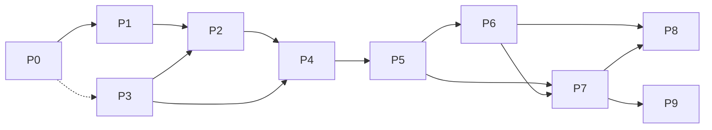

# 08 — Implementation Plan

Tags: **[V]** verified · **[R]** reported · **[A]** design decision / assumption to validate.

## 14. Repository and crate structure

Cargo workspace in this repo (edition 2024, resolver 3, release profile `lto="thin"`, `codegen-units=1`, `strip` — CrownOS convention [V]). Utilities live in `src/util/<name>.rs` inside each crate. Libraries use `thiserror`, binaries `anyhow`; logging via `tracing` + `tracing-journald`.

```
crownos-visual-context-engine/
├── Cargo.toml                    # [workspace]
├── crates/
│   ├── context-protocol/         # public wire contract (crownos-ipc protocol!), shared IDs/types; no daemon deps
│   ├── context-core/             # Observation, Trigger, Segment/Episode domain types, time, ids (newtypes)
│   ├── context-policy/           # rules (RON via crownos-config), sensitivity, secret detectors, scopes, consent
│   ├── context-store/            # SQLCipher schema + migrations, writer task, read pool, FTS5/vec0 queries, audit chain
│   ├── context-collect/          # compositor bridge (calloop wayland client), a11y, crownui tree, notify, clipboard, proc/project, files, power
│   ├── context-capture/          # capture scheduling, damage tiles, volatile masks, crops, frame memory (memfd lifecycle), RAM frame queue, line cache
│   ├── context-engine/           # correlator, segmenter, classifier, working memory, memory manager, scheduler, consolidation, retrieval
│   ├── context-infer/            # modality traits, task layer, registry v2, router; no runtime deps
│   ├── context-infer-ort/        # ort backend: OCR, embeddings, rerank (unsafe allowed)
│   ├── context-infer-llama/      # llama.cpp backend: generate + mtmd vision, dynamic ggml modules (unsafe allowed)
│   ├── context-infer-http/       # OpenAI-compatible backend: sidecars, LAN, cloud
│   ├── crown-contextd/           # bin: broker daemon (tokio, 2 workers + wayland thread + writer thread)
│   ├── crown-context-inferd/     # bin: inference worker (ort + llama backends, no network)
│   ├── crown-context-relayd/     # bin: optional host of the HTTP backend (text only)
│   ├── crown-context-mcp/        # bin: optional MCP agent bridge
│   └── crown-context/            # bin: CLI (status, search, timeline, explain, forget, pause, export, bench)
├── models/registry.ron           # model catalog v2 (models with capability tags and per-runtime artifacts; task → ranked candidates)
├── packaging/systemd/            # *.socket, *.service user units + preset
├── eval/                         # corpora manifests, gold sets, trace fixtures (synthetic, privacy-safe)
├── tools/                        # offline model export/quantization scripts (Python allowed; not shipped)
└── docs/                         # this blueprint
```

Cross-repo work items are listed in [07 §13.6](07-api.md#136-changes-to-existing-crownos-interfaces). Dependencies on siblings via path deps with `[patch]` (CrownOS convention [V]).

## 15. Implementation workstreams and phases

Since 2026-11-23 the work runs as parallel workstreams. The phases stay as milestones and keep their numbers. Each phase is independently testable and ends with a demo + measured acceptance criteria. "Depends on" lists hard prerequisites only.

| WS | Workstream | Scope | Phases | Depends on |
|---|---|---|---|---|
| W1 | Access control | crownos-config, crownos-ipc, crownos-protocols, crownpositor, xdg-desktop-portal-crownos, contextd, crownos-settings | 1 (and the API scope checks used by 7) | none |
| W2 | Model layer + inferd | `context-infer*`, `crown-context-inferd`, `models/`, crownos-config `ai.rs` | 3 | none |
| W3 | Capture, analyse then delete | `context-capture`, contextd, store, systemd units | 2 | W2 traits (a stub is enough) |
| W4 | Accessibility | `context-collect/a11y`, crownpositor session startup, crownos-computer-use `atspi` bump | 2 | none |
| W6 | Benchmarks (alongside) | `eval/`, bench binaries | 0, then every phase | W2 backends |

W0 (these docs), W5 (crownos-secrets-manager, a separate component) and W7 (integration: agent skills, installer, ISO pins) run outside this repo. Merge order on GitHub `main`: crownos-config → crownos-ipc → crownos-protocols → crownpositor → xdg-desktop-portal-crownos → VCGE → crownos-settings → crownos-computer-use.

### Phase 0 — Foundations and de-risking spikes

**Workstream:** W6 benchmarks start here and run alongside every later phase.

**Features:** workspace scaffold, CI gates, benchmark harnesses, hardware bake-off, protocol drafts.

**Steps (todo list):**
1. Scaffold workspace + crates (empty APIs), CI: `cargo fmt --check`, `clippy -D warnings`, `cargo test`, `cargo deny` (licences), x86_64 builds. aarch64 is a future track and not a gate here.
2. Draft `crownos-context-v1.xml` version 2 + `crownos_capture_privacy_v1.xml`; review with compositor owners.
3. Hardware bake-off (`bench-ocr`, `bench-embed`, `bench-llm`, `bench-vlm`). First on the dev machine: Ryzen 7 7840HS (XDNA1 NPU), Radeon 780M (Vulkan), RTX 4050 Laptop (CUDA), 14 GiB RAM. Then an Intel LNL/PTL and an AMD Ryzen AI 300 when available. Record model × runtime × device latency/accuracy/memory → fills `registry.ron` v2. Candidates: OCR PP-OCRv6 tiny/small vs Tesseract; VLM Qwen3.5-2B/4B, Qwen3-VL-2B, SmolVLM2 (CPU); LLM Qwen3.5-2B/4B; embeddings Qwen3-Embedding-0.6B vs EmbeddingGemma-300m vs bge-m3.
4. Spikes: (a) `llama-cpp-2` `dynamic-backends` with CUDA + Vulkan modules in one binary (the feature exists [V]; the co-build is untested); (b) `ort` rc.15 `load-dynamic` with OpenVINO/VitisAI/CUDA EPs on CrownOS ORT packages; (c) sqlite-vec + SQLCipher in one `rusqlite` build; (d) `bench-a11y` with `IsEnabled` in four states; (e) `SO_PEERPIDFD` and `SO_PASSPIDFD` on target kernels; (f) capture into a sealed, `mlock`ed memfd as a `wl_shm` pool, and `memfd_secret` as an option.
5. Build OCR eval corpus (500 crops of UI, code, terminal, dark mode, CJK; synthetic + self-captured with consent) and synthetic "day in the life" trace generator.

**Dependencies:** none. **Interfaces:** draft XML, `registry.ron` v2 schema.
**Testing:** harnesses run in CI on CPU; hardware runs manual with results committed to `eval/results/`.
**Acceptance:** every [A] item in 04-inference §10.3 for T1, T2 and T4 confirmed or replaced; spike reports written.

### Phase 1 — Compositor integration, access control and event collection

**Workstream:** W1 access control, plus the compositor bridge.

**Features:** `crownos_context_v1` version 2 server in crownpositor (window fan-out incl. plugin-host events, pid/pidfd, sensitivity state machine without engine flags, input buckets, selection metadata, idle/lock, pause hotkey; many binders with per-client scope and `revoked`); access control ([05 §11.3](05-privacy-security.md#113-caller-identity-and-scopes)): `AppKey`, scopes, `context_access.ron`, first-use consent, live revocation; contextd skeleton with compositor bridge, per-request scope check, policy gate (exclusions), heartbeat-merged event log (unencrypted dev DB allowed only in this phase), `crown-context status/tail` CLI.

**Steps:**
1. crownos-config: `context_access` section; migrate `trusted_executables` → `exe:` and `app_access` → `sandbox:`; add `agents`, `visual_context`, `context_access` to the by-name API.
2. crownos-ipc: `SO_PEERPIDFD` instead of `pidfd_open`; opt-in `SO_PASSPIDFD` sender check per frame; pass the peer identity into generated handlers.
3. crownos-protocols: XML version 2 + generated server/client bindings.
4. crownpositor: `context/` module; hook `update_keyboard_focus`, title/app_id/map/unmap, `refresh_foreign_toplevels`, text-input activation, `new_selection`, idle/lock; input bucket counters; hotkey; emit plugin-host window events; `AppKey` at accept and bind; `ContextState.bound: Vec<Bound>` with per-client event filtering; revoke on config reload; first-use prompt through `PendingPrompts` + portal; consent dialogs ignore synthetic input; blank sensitive windows in output screencopy and screencast; audit to `crownpositor::audit::context`.
5. xdg-desktop-portal-crownos: `AccessDialog` returns the choices (remember, scope); ship it in the ISO.
6. contextd: calloop wayland thread → bounded channel → tokio; window table keyed by foreign-toplevel identifier; pidfd → cgroup app resolution (reuse `monitor-system` resolver); `Authorizer::Custom` with scope check per request; audit actor = `AppKey`; policy gate v0; event log writer.
7. crownos-settings: **Privacy** group with *Screen context* and *App access* pages.
8. CLI `crown-context tail` prints live observations.

**Dependencies:** Phase 0 (XML approved).
**Interfaces:** `crownos_context_v1` v2, `crownos_plugin_host_v1` events, `context_access.ron`, `context-core::Observation`.
**Testing:** compositor unit tests for sensitivity state machine and bucket aggregation (incl. password zeroing); integration test with nested (winit) crownpositor + scripted GTK/Qt test clients; access-control tests in a nested crownpositor (ungranted app gets nothing; first-use prompt; `metadata` grant gets no titles; revoke in Settings; a second binder works; a sandboxed client is denied by default; synthetic input cannot press "Allow"); `bench-compositor`.
**Acceptance:** focus/title/app/pid events for native + XWayland windows within 16 ms of change; password-purpose input yields zero text counts; a revoke in Settings cuts a live Wayland client and an IPC peer within one frame; no frame-time regression (§12.1); crownplugind receives window events.

### Phase 2 — Screen capture (analyse, then delete) and accessibility extraction

**Workstreams:** W3 capture and W4 accessibility.

**Features:** capture scheduler with trigger set (§7.3), focused-window `ext-image-copy-capture` sessions (shm in a per-capture memfd), damage tiles, volatile-region masks, frame lifecycle and RAM queue ([05 §11.6](05-privacy-security.md#116-analyse-then-delete)), compositor sensitivity veto, engine `flag_sensitive`, secret detectors on all extracted text; session-wide AT-SPI extractor; CrownUI tree reader; crownbar indicator; notifications (crownotify `NotificationPosted`) and clipboard metadata/content collectors.

**Steps:**
1. Compositor: veto in `capture_constraints`/frame path for VCGE client; indicator state; set `org.a11y.Status.IsEnabled=true` at session start, before any app launches.
2. `context-capture`: session lifecycle (only focused window), trigger debounce/gates, tile hashing within damage, crop extraction, frame memory in `src/util/frame_memory.rs` (memfd, `mlock`, `MADV_DONTDUMP|MADV_WIPEONFORK`, `F_SEAL_FUTURE_WRITE|SHRINK|GROW`, `zeroize`, close), RAM queue (3 frames / 64 MB, latest wins per window, 60 s TTL, `frame_dropped_unanalysed`).
3. contextd: act on capture events; call `context-policy::find_secrets` on extracted text and on clipboard text; logind `PrepareForSleep` delay inhibitor.
4. systemd units: `PR_SET_DUMPABLE=0`, `LimitCORE=0`, `MemorySwapMax=0`, `MemoryZSwapMax=0`, `LimitMEMLOCK=128M`. Store: drop `thumb_path` from the unreleased V1 migration.
5. `context-collect::a11y`: minimum event set; `GetMatches` (Qt, ATK bridge) / `GetItems` (GTK4) / concurrent bounded walk (≤ 2,000 nodes, 200 ms per app); Chromium call allowlist; per-app adaptive backoff, dead/hung object cache, SimHash dedup, SHOWING/VISIBLE filter; pid+title window mapping; `password_text` role → `flag_sensitive`. crownos-computer-use moves `atspi` to 0.30.
6. crownotify + crownbar changes; clipboard collector honoring secret hint and per-app allowlist.

**Dependencies:** Phase 1; Phase 3 traits (a stub is enough).
**Interfaces:** `ext-image-copy-capture-v1`, AT-SPI, crownotify/crownos-clipboard IPC, `crownos_capture_privacy_v1`, inference `read_text` / `describe_screen`.
**Testing:** privacy red-team suite v1 (password field in GTK/Qt/Chromium, Firefox private window, excluded app, locked session, app self-exclusion, planted secrets on screen and in the clipboard) asserting **zero pixels and zero text stored**; frame lifecycle test (capture for 1 h in a nested crownpositor, then scan the state dir, `/tmp`, `$XDG_RUNTIME_DIR` and swap for any image file or pixel blob; kill inferd mid-job); capture-rate tests from replayed traces; `bench-a11y` in four states; a11y budget tests against a huge DOM page.
**Acceptance:** red-team suite 100 % pass; zero image files or pixel blobs found; captures/min within §12.1 on a 1-h scripted session; a11y text available for GTK/Qt/Firefox/Chromium apps with no launch flag; `bench-a11y` ≤ 5 % CPU and ≤ 10 % RSS above "off"; indicator reflects state within 250 ms.

### Phase 3 — Model layer, inference worker and OCR

**Workstream:** W2 model layer.

**Features:** the swappable model layer ([04 §10.4](04-inference.md#104-model-layer-in-context-infer)): `context-infer` modality traits (`Generate`, `Embed`, `Rerank`, `Ocr`, `Transcribe`) and task layer, `registry.ron` v2, router (probe, cached benchmark in `backends.ron`, circuit breaker per (runtime, device), deadline fall-through); backends `context-infer-ort`, `context-infer-llama` (CUDA/Vulkan/ROCm/CPU ggml modules, `mtmd`), `context-infer-http` (hosted by relayd); `crown-context-inferd`; PP-OCR det/rec on changed crops, line-level cache (text only, scroll-invariant), window text state + text deltas, text-source priority (CrownUI > a11y > OCR), content-type/fullscreen gating; capture-time `describe_screen` for low-text frames. crownos-config `ai.rs`: split `Device` from `Runtime`, add `Vulkan`, `TensorRt`, `Rocm`, `Remote`.

**Steps:** traits + task layer; registry v2 loader; router; ort backend; llama backend with dynamic ggml modules; http backend; inferd daemon + socket activation + idle exit; memfd job protocol; OCR pipeline with static-shape buckets; text-state merge; VLM caption gate.
**Dependencies:** Phase 0 (bake-off fills the registry; the traits can start at once).
**Interfaces:** `crownos-visual-context-infer`, `registry.ron` v2.
**Testing:** `bench-ocr` CER/latency and `bench-vlm` per runtime and device; structured-output conformance test per backend and task schema; swap test (a registry edit changes the model with no code change); fault injection (kill inferd mid-job, hung EP) → contextd requeues text jobs, frames end within their TTL, no data loss; terminal `sudo` prompt detection test.
**Acceptance:** CER ≤ 3 % on UI/code corpus; OCR p95 latency per §12.1; ≥ 60 % of captures skip OCR entirely via a11y coverage/line cache on the soak trace; inferd crash never affects contextd; a model swap needs only a registry edit.

### Phase 4 — Event correlation and activity segmentation

**Features:** correlator (10-min window joins: input→capture cause, copy→source, notification→app), doc_key derivation, segment state machine, episode chaining, activity classifier (rules + embedding centroids, needs text embedding in inferd), project detection from git roots/doc folders, working memory + `current_context` + `subscribe(ContextChanged)`.

**Steps:** pure-function segmenter/correlator over `Observation` streams; doc_key normalizers (title cleanup, URL canonicalization, terminal cwd→git root); classifier prototypes; working memory snapshot/restore; Context API v0 (`status`, `current_context`, `subscribe`).
**Dependencies:** Phases 1–3.
**Interfaces:** Context API (subset), `context-core` segment types.
**Testing:** **deterministic replay** of synthetic traces with golden segment/episode outputs; property tests (segments never overlap per window, total active time ≤ wall time); classifier accuracy on labeled traces.
**Acceptance:** segmentation F1 ≥ 0.9 vs gold boundaries; activity label accuracy ≥ 85 % on gold traces; `ContextChanged` p99 < 50 ms.

### Phase 5 — Episodic and working memory (persisted, encrypted)

**Features:** SQLCipher store with final schema for events/segments/frames (capture records, no pixels)/text_lines/episodes/jobs/audit; key management (systemd-creds/keyring); FTS5 indexing; segment/episode summarization through the task layer with JSON schema; importance scoring; retention + quota pruning; `forget` with cascade; `timeline`, `episode`, `explain` APIs; CLI `timeline/explain/forget`.

**Steps:** migrations; writer task with coalesced transactions; DEK/KEK handling + zeroization; `summarize_segments` through the task layer with a JSON schema; batching policy (§10.6); retention worker; audit chain.
**Dependencies:** Phase 4.
**Interfaces:** Context API (timeline, episode, explain, forget, status), inference `generate`.
**Testing:** crash-consistency tests (kill -9 during writes); DB opened without key fails; deletion cascade property tests; JSON validity ≥ 99 %; **8-h soak** on T1/T2/T4 measuring all §12.1 targets.
**Acceptance:** soak meets §12.1; "what was I working on yesterday" answered from timeline with correct episodes on gold traces; `forget(last 15 min)` removes all derived artifacts (verified by scan).

### Phase 6 — Semantic, project, and procedural memory

**Features:** entity/fact extraction pipeline (deterministic extractors + LLM JSON), entity resolution (alias → similarity → LLM adjudication), bi-temporal fact store with invalidation, mentions, project profiles + `project`/`resume_context` APIs, procedural mining (symbolization + constrained sequential mining), preference aggregation, consolidation scheduler (idle + AC, abortable, checkpointed).
**Dependencies:** Phase 5.
**Interfaces:** `entity`, `project`, `resume_context`, `procedures`, `preferences`, `remember`, `correct`.
**Testing:** extraction F1 vs gold; contradiction tests (fact A then ¬A → A invalidated with correct intervals); procedure mining on synthetic traces with planted workflows (precision/recall); consolidation abort latency < 100 ms on input.
**Acceptance:** entity F1 ≥ 0.7, fact precision ≥ 0.8 on gold; planted procedures recovered (recall ≥ 0.8, precision ≥ 0.7); resume_context names the right last file/doc/URL in ≥ 90 % of gold cases.

### Phase 7 — Hybrid search and context retrieval

**Features:** query parser (time, app, entity), FTS5 + vec0 + graph expansion, RRF fusion, optional reranker, `search`, `context_pack`, fresh-auth for the `raw` scope (scope checks exist since Phase 1), rate limiting; Inspector UI (CrownUI app or crownos-settings pane) with timeline, search, "why", forget, policy; export.
**Dependencies:** Phase 5 (search over episodic), Phase 6 (entity expansion).
**Interfaces:** Context API complete v1.
**Testing:** `bench-search` on 1-year synthetic store; retrieval eval (recall@10, MRR) on question sets ("where did I see…", "what did X say about…"); scope enforcement tests (agent without `raw` never receives raw text); fuzzing of postcard decode (`cargo-fuzz`).
**Acceptance:** recall@10 ≥ 0.85 and MRR ≥ 0.6 on eval set; latency per §12.1; all scope tests pass; audit records every query.

### Phase 8 — Advanced capture-time understanding and consolidation

**Features:** UI element detection (icon_detect_v3, dGPU tier, at capture time) for no-a11y apps, document-OCR mode at capture time for dwelled pages, day/week rollups, project profile versioning, LAN and cloud endpoints through the HTTP backend with redaction + consent + budget, optional browser native-messaging host.
**Dependencies:** Phases 5–7.
**Testing:** VLM budget adherence; redaction test suite (planted secrets/PII never leave — relayd re-verification blocks); no frame ever reaches relayd; LAN Spark end-to-end with mTLS.
**Acceptance:** zero planted secrets in captured relay payloads; zero frames in relay payloads; VLM ≤ budget.

### Phase 9 — Integration with CrownOS agents

**Features:** `crown-context-mcp` (tools: `context.current`, `context.search`, `context.timeline`, `context.project`, `context.entity`, `context.pack`, `memory.remember`), agent grant flow, `ProcedureDetected` → automation offers via CrownOS agents, launcher/shell integrations (project resume on open, "continue where you left off"), referent resolution ("this document" → current doc_key).
**Dependencies:** Phase 7 (Phase 6 for procedures).
**Testing:** end-to-end agent scenarios from the brief (yesterday's work, project reopen, "which document", "where did I see", workflow automation offer, pre-task context); permission denial paths.
**Acceptance:** all six brief scenarios pass on gold traces with correct provenance; agents never exceed granted scopes.

### Phase dependency graph

W1 (Phase 1), W2 (Phase 3) and W6 (Phase 0) start at the same time. The dotted edge means the bake-off fills the registry; the traits do not wait for it.



## 16. Technical dependencies

| Area | Crate / component | Version (2026-11) | Notes |
|---|---|---|---|
| Wayland client | `wayland-client` / `wayland-protocols` 0.32 / calloop 0.14 | match crownpositor [V] | generated bindings from crownos-protocols |
| Compositor | smithay git rev pinned by crownpositor [V] | — | no Smithay bump required for VCGE [A] |
| IPC | `crownos-ipc` (tokio adapter) | path dep [V] | |
| Config | `crownos-config` | path dep [V] | |
| Async | `tokio` 1.5x | [V] | |
| D-Bus | `zbus` 5.x, `atspi` 0.30 | [V] | align zbus major with atspi |
| DB | `rusqlite` 0.41 (`bundled-sqlcipher`), `sqlite-vec` 0.1.9 | [V] | |
| Optional ANN | `usearch` 2.26 | [V] | only if > 1 M vectors |
| Inference | `ort` 2.0.0-rc.15 (`load-dynamic`), `llama-cpp-2` 0.1.161 (`dynamic-backends`, `mtmd`) | [V] | no CrownOS-wide ort pin yet; move crowndictator (rc.15 static) and crownos-voice (rc.12) to the same pin as a follow-up |
| Model layer | `schemars` (output schemas), a thin OpenAI-compatible HTTP client | [A] | HTTP client only in `context-infer-http` |
| Imaging | `xxhash-rust` (tile hashes), `fast_image_resize` (SIMD downscale for the VLM) | [A] | no image encoding: frames are never written |
| Crypto | `zeroize`, `secrecy` | [A] | SQLCipher handles DB |
| Sandboxing | `landlock`, `rustix` (pidfd, memfd seals, `mlock`, `madvise`) | [A] | |
| MCP | `rmcp` (as crownui) [V] | | |
| Testing | `criterion`, `proptest`, `insta`, `cargo-fuzz` | | |
| Runtime libs (system packages) | `onnxruntime-crownos[-cuda\|-openvino\|-vitisai]`, ggml modules (CUDA, Vulkan, ROCm, CPU variants), Mesa Vulkan, NVIDIA CUDA 13 | [V]/[A] | `-qnn` and aarch64 variants are a future track |

## 17. Testing and benchmarking strategy

1. **Deterministic replay is the backbone.** Observations are serializable; a trace format (`eval/traces/*.postcard`) replays through correlator/segmenter/memory with a fake clock and fake inferd (canned OCR/LLM outputs) → golden snapshots (`insta`). No real user data in the repo: traces are synthetic or recorded on test accounts.
2. **Unit tests** per crate (same file `#[cfg(test)]`): policy rules, secret detectors, tile diff, doc_key normalizers, bi-temporal invalidation, RRF.
3. **Property tests:** no overlapping segments; deletion cascade leaves no orphan evidence; facts never have `valid_to < valid_from`; sensitivity ⇒ no capture.
4. **Integration:** nested crownpositor (winit backend) + scripted test clients (GTK4, Qt6, Chromium/Electron, Firefox, foot/terminal, XWayland app); real AT-SPI bus.
5. **Privacy red-team suite** (gated in CI from Phase 2): planted passwords, private windows, excluded apps, lock screen, secrets in clipboard/OCR → assert absence in DB, logs and relay payloads, and no image file or pixel blob anywhere on disk.
6. **Access-control suite** (from Phase 1): ungranted app, first-use prompt, `metadata`-only grant, live revocation, second binder, sandboxed default deny, synthetic input on consent dialogs.
7. **Model evals:** OCR CER, embedding recall, extraction F1, JSON validity, VLM description usefulness (rubric), per tier — rerun on any registry change.
8. **Performance:** criterion micro-benches; `bench-compositor`; 8-h soak + 2-h battery runs per tier before each phase sign-off; regressions > 10 % fail the gate.
9. **Robustness:** fault injection (kill inferd/contextd, full disk, DB corruption, hung EP, compositor restart), fuzzing of IPC decoders and Wayland event handlers.
10. **Quality gates:** `cargo fmt -- --check && cargo clippy -- -D warnings && cargo test` + `cargo deny check licenses`.

## 18. Major engineering risks and mitigations

| # | Risk | Likelihood / impact | Mitigation |
|---|---|---|---|
| 1 | **Snapdragon NPU unusable on Linux** (X1 hobbyist, X2 preview) [R] | High / Medium (future track) | Plan T3 as CPU + Adreno Vulkan (measured faster than NPU for LLM decode [R]); QNN behind experimental flag; revisit when FastRPC is upstream |
| 2 | **No aarch64 packaging in CrownOS** [V] | Certain / High for CrownOS on Snapdragon & Spark | Future track, not an MVP gate: aarch64 base system, kernel/firmware for X1/X2, CUDA aarch64 for Spark. A Spark on the LAN needs no CrownOS package |
| 3 | AT-SPI global enablement costs CPU/RAM in every app; GTK4 emits all events once any listener exists | Medium / Medium | `bench-a11y` gate in Phase 2; minimum event set; Chromium call allowlist; fallback per-app enablement; CrownUI MCP tree preferred; OCR covers gaps |
| 4 | OCR quality on dense/dark UIs and CJK | Medium / Medium | a11y-first; PP-OCR tiers per hardware; corpus-driven model choice; document-OCR mode for dwelled pages |
| 5 | LLM hallucinated memories | Medium / High (trust) | Facts only from evidence; provenance + confidence; low-confidence expiry; user correction; never shown as certain without source |
| 6 | Privacy failure (stored password, private window) | Low / Critical | Compositor-side veto independent of contextd; fail-closed gates; red-team suite as CI gate; secret detectors; audit |
| 7 | DB exfiltration by user-level malware | Medium / High | SQLCipher + key isolation + fresh-auth raw scope + rate limit + audit; acknowledge same-uid limits (Recall lesson [R]) and track `crownos_session_v1` separate-user direction |
| 8 | Resource regressions (battery drain, GPU contention with games) | Medium / High | Budgeted scheduler, PSI/power/fullscreen gating, soak + battery gates per phase |
| 9 | Runtime/EP churn (ORT 1.24→1.31, plugin EPs, `ort` RC, `llama-cpp-2` 0.1.x API) [V] | High / Medium | One `ort` pin (rc.15, `load-dynamic`), others to follow; one shared llama wrapper; circuit breaker per (runtime, device); CPU fallback always present |
| 10 | Smithay master churn (`Dispatch2`) | Medium / Low | crownpositor already pins a rev [V]; context module kept small behind an internal trait |
| 11 | Model licences | Low / High | `registry.ron` records licence; `cargo deny`-style licence check for models; excluded list in 04 §10.2 |
| 12 | Storage growth | Medium / Low | Quota + tiered retention; text only, no pixels stored |
| 13 | Scope creep into a "screen recorder" | Medium / Medium | No continuous video; memory-first schema; no pixels stored |
| 14 | User trust / creepiness | Medium / High | Visible indicator, pause hotkey, Inspector "what we collect", per-memory "why", easy forget, opt-in for sensitive categories |
| 15 | Host-app access control is consent, not enforcement | Certain / Medium | State it in Settings; enforce for sandboxed apps; move first-party daemons to `Spawned`; per-frame `SO_PASSPIDFD` on the Context API |
| 16 | Frame lost before analysis, or VLM vision encoder falls back to CPU (82 s seen [R]) | Medium / Medium | RAM queue with TTL and `frame_dropped_unanalysed` metric; deadline per job; VLM only on tiers that pass `bench-vlm` |

## 19. MVP scope and long-term roadmap

### MVP (Phases 0–5 + search half of Phase 7)

- Compositor context protocol, sensitivity veto, pause hotkey, indicator.
- Event-driven focused-window capture, analysed at capture time and then deleted: a11y + CrownUI + OCR text, and a short VLM caption for low-text frames where the tier allows it.
- Segments, episodes with small-LLM summaries, working memory, `current_context`, `timeline`, FTS5 + vector `search`, `explain`, `forget`.
- Encrypted store, retention, audit.
- Per-app access control: `AppKey`, scopes, `context_access.ron`, first-use consent, live revocation, Settings *Privacy* pages.
- Swappable model layer with ort, llama.cpp and HTTP backends.
- Tiers T1, T2 and T4 on x86_64 with CPU/Vulkan/CUDA; NPU EPs where Phase 0 validated them (Intel, AMD). A Spark on the LAN is optional.

**Out of MVP:** semantic/project/procedural/preference memory, UI element detection, document-OCR mode, cloud endpoints, MCP bridge, Inspector UI, aarch64.

### Roadmap

| Horizon | Deliverables |
|---|---|
| MVP | above |
| +1 milestone | Phase 6 (semantic/project/procedural/preference), full Phase 7 (context_pack, scopes for agents, Inspector UI) |
| +2 | Phase 8 (UI detection, document OCR, rollups, LAN and consented cloud endpoints) |
| +3 | Phase 9 (MCP bridge, automation offers, shell/launcher integrations) |
| Later | aarch64 track (CrownOS on Snapdragon X and DGX Spark); Snapdragon NPU via upstream FastRPC/QNN EP; Wayland-native a11y if a protocol emerges; cross-device memory sync between a user's CrownOS devices (E2E-encrypted, via crownlink); federated per-device memory with Spark as home hub; learned importance from retrieval feedback |
